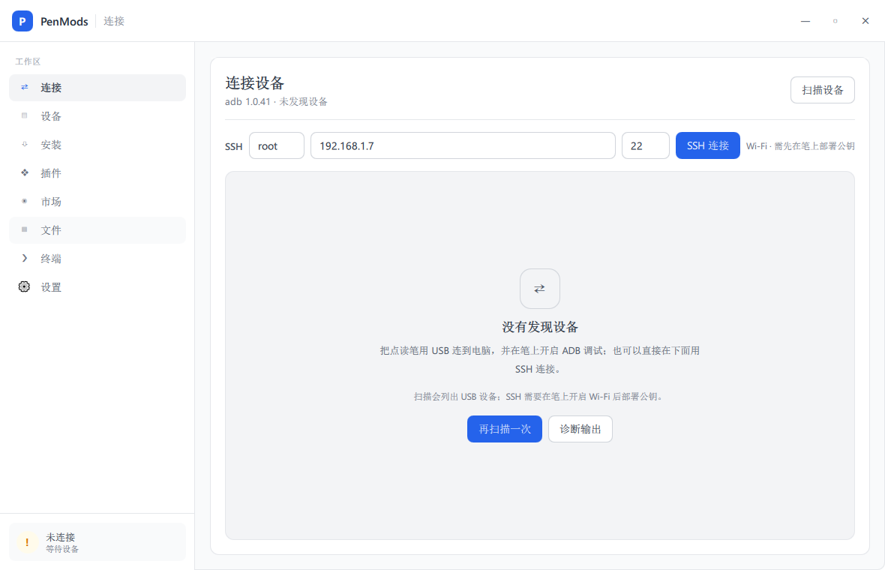

# PenMods 管理器

面向 Windows 10/11 的**有道词典笔**桌面管理工具：ADB / SSH 双通道连接、设备信息、安装 PenMods 与可选组件、
OTA 更新、插件与安装包管理、插件市场、文件浏览 / 终端 / 配置编辑、以及 PenMods V2.7.3 启动器迁移。

界面是 **PySide6 + Qt Quick (QML)** 渲染的原生桌面程序（液态玻璃：浅/深色主题、7 种强调色、动态或照片背板、圆角窗口），
**不是本地网页**。里程碑见 [docs/PLAN.md](docs/PLAN.md)，
C 核心与 GUI 之间的 JSON 协议见 [docs/PROTOCOL.md](docs/PROTOCOL.md)。



## 功能

| 页面 | 能力 |
| --- | --- |
| 连接 | **ADB**（`adb devices` 扫描）与 **SSH 直连**（IP/端口 + ed25519 密钥，首次连接固定主机密钥，之后拒绝换钥）；SSH 连上后所有页面自动改走 SSH |
| 设备 | 13 条探针：型号/系统/PenMods 版本、存储、运行时间、SSH 状态、ADB/SSH 自启等，附原始 JSON |
| 安装 | v2.7+ 组件式安装（core/player/mathjax/ppocr，stage → 待启用 → 启用并重启 / 取消）；≤2.6 走 patchelf 注入；OTA 检查；**V2.7.3 启动器迁移横幅** |
| 插件 | 已装插件列表、启用/禁用（`.disabled`）、卸载（备份可回滚）、zip 路径在线安装 |
| 市场 | 协议 v1 静态索引：内置示例 / 本地 index.json / HTTPS 索引 / GitHub 仓库链接直装 |
| 文件 | 设备目录浏览、进入目录、单文件下载到本机 |
| 终端 | 远端命令原样执行（ADB/SSH 通用），4 个常用快捷命令 |
| 设置 | 运行环境信息、安全约定、`PenModsconfig.json` 自启与跳过鉴权开关、SSH 身份卡片、外观（主题色/背板壁纸） |

全局：任意页面把 `.zip` 拖进窗口即跳到插件页并安装。

## 安全边界（请先读）

- 插件在笔上**与主程序同进程、以 root 运行、没有沙箱**——只安装可信来源的插件。本仓库不放 root 终端类插件（`shell_plugin` 已排除），本地侧载时风险自负。
- 所有下载都会做 SHA256 校验；市场索引强制 HTTPS；zip 安装拒绝符号链接与路径穿越；SSH 主机密钥固定。
- 写设备只覆盖 `*.tmp/new` 再同目录 `mv -f`，安装结束统一 `killall YoudaoDictPen` 让库重新生效，但**不会自动重启设备**。
- 首次启动会弹出使用须知与免责声明，必须读到底才能继续。

## 安装与运行

需要 **Windows 10/11 x64**、Python 3.10+、`adb`（打包版已内置）。

```powershell
# 1. 依赖（Qt QML 运行时）
pip install PySide6-Essentials==6.12.0

# 2. 开发模式运行（自动把 app/ 与依赖目录加进 sys.path）
python src/scripts/run_app.py

# 3. 冻结打包（PyInstaller onedir，产物在 dist/PenModsManager/）
python src/scripts/build_dist.py
```

C 核心 `penctl.exe` 是纯 C（无第三方库），构建方式见 [BUILD.md](BUILD.md)。
发布产物（`release/PenModsManager-*-win64.zip`）不放进 git，作为 GitHub Release 附件上传。

## 插件与市场

`plugins/` 里是 8 个可安装的插件包、`SHA256SUMS`，以及一份第三方静态审计报告
[plugins/SECURITY-AUDIT.md](plugins/SECURITY-AUDIT.md)（不构成安全保证，安装前请自行判断）。

市场索引（协议 v1）的默认地址已指向本仓库：`https://raw.githubusercontent.com/Zikuishanlu/penmods/main/plugins/index.json`
（`app/penmanager/market.py` 的 `DEFAULT_INDEX_URL`）。索引要求每个下载地址都是绝对 HTTPS URL，
所以在仓库建好后生成一次即可，步骤见 [plugins/README.md](plugins/README.md)：

仓库里已附带生成好的 `plugins/index.json`（指向本仓库）。**换包或改仓库名后重新生成一次**：

```powershell
python src/scripts/make_market_index.py --base-url https://raw.githubusercontent.com/Zikuishanlu/penmods/main/plugins
```

> 建仓库时仓库地址为 `Zikuishanlu/penmods`；若改了账号或仓库名，把这一处常量、下面这条命令和 `plugins/index.json` 里的地址一起改掉。

`raw.githubusercontent.com` 在部分网络（如中国大陆）会被阻断，所以 `market.mirror_urls()` 会在直连失败后
自动改用 jsDelivr 镜像（`https://cdn.jsdelivr.net/gh/Zikuishanlu/penmods@main/plugins/index.json`），
不需要在界面上手填；也可以把镜像地址直接粘贴到市场页的「索引 URL」。

产物是 `plugins/index.json`（含每个包的 `sha256`，更换包后要重新生成）与 `plugins/SHA256SUMS`。
索引就位后，市场页默认即可列出这些插件；也可以直接把 GitHub 仓库链接填进「从仓库安装」。

## 目录结构

```
src/            程序源码（Python + QML + C 核心 + 测试 + 构建脚本）
docs/           设计文档、协议、插件发布说明、截图
plugins/        插件包 + 校验和 + 审计报告 + 市场索引 index.json
release/        打包产物（git 忽略，作为 Release 附件）
```

## 许可证

本项目代码以 [MIT](LICENSE) 发布。第三方组件（Qt/PySide6、Android platform-tools、示例照片、插件包）的许可见 [NOTICE.md](NOTICE.md)。
